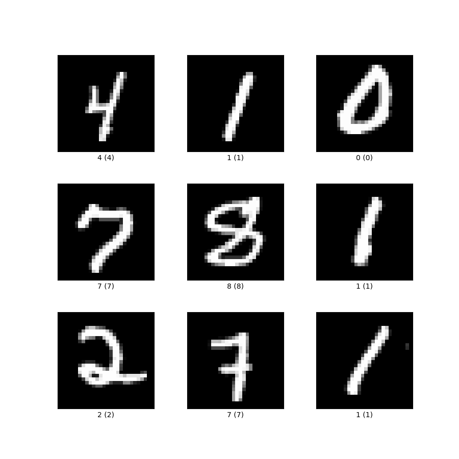

# Classifier Notes

## 1 Input Data

   
  <em>Figure 1: Examples of MNIST dataset</em>

The classifier model is currently designed to work with the MNIST dataset which is
a dataset of 41,000 images of handwritten digits. Our goal with this model is to
train a classifier network with these images and use that network to predict new
unseen images and classify them into one of the 10 classes (0-9). Each image is 28x28
pixels and each pixel has a value between 0 and 255 (0 representing white and 255
representing black). We use the first 40,000 images for training and the last 1,000
images for testing to ensure that the model is generalizing well to unseen data.
Our initial dataset is a csv file with 41,000 rows and 785 columns, where each
row represents an image. The first column is the label of the image (0-9) and the
remaining 784 columns are the pixel values of the image (28x28=784) as seen in table 1.

| **Label** | **Pixel 1** | **Pixel 2** | **Pixel 3** | **Pixel 4** | **Pixel 5** | **Pixel 6** | … | **Pixel 783** | **Pixel 784** |
|:-:|:-:|:-:|:-:|:-:|:-:|:-:|:-:|:-:|:-:|
| 0 | 0 | 1 | 2 | 3 | 4 | 5 | … | 0 | 1 |
| 1 | 9 | 8 | 7 | 6 | 5 | 4 | … | 2 | 3 |
| 2 | 3 | 4 | 5 | 6 | 7 | 8 | … | 4 | 5 |

<em>Table 1: Example table showing the input data csv file</em>

To get the data into a useable format for the model, we need to vectorize both the
pixel values and the labels. We'll first import the data into python using a pandas
dataframe and then convert the dataframe into a numpy array and shuffle it randomly.
Our first task is to split the data into training and testing sets. We'll then split
the data into features (pixel values) and labels (0-9) after transposing our array (
so pixel values are now column vectors). We'll also normalize the pixel values by
dividing each feature vector by 255.0 to ensure that the pixel values are between 0
and 1. We'll then one-hot encode the labels so that they are in the form of a 10x1.
We end up with 4 arrays: X\_train, y\_train, X\_test, y\_test.

$$
X_{tr} = \begin{bmatrix}
    x_{1,1} & x_{1,2} & \dots & x_{1, 40,000} \\
    x_{2,1} & x_{2,2} & \dots & x_{2, 40,000} \\
    \vdots & \vdots & \ddots & \vdots \\
    x_{784, 1} & x_{784, 2} & \dots & x_{784, 40,000}
\end{bmatrix}
Y_{tr} = \begin{bmatrix}
    y_{1,1} & y_{1,2} & \dots & y_{1, 40,000} \\
    y_{2,1} & y_{2,2} & \dots & y_{2, 40,000} \\
    \vdots & \vdots & \ddots & \vdots \\
    y_{10,1} & y_{10,2} & \dots & y_{10, 40,000}
\end{bmatrix}
\tag{1}
$$

$$
X_{te} = \begin{bmatrix}
    x_{1,1} & x_{1,2} & \dots & x_{1, 1,000} \\
    x_{2,1} & x_{2,2} & \dots & x_{2, 1,000} \\
    \vdots & \vdots & \ddots & \vdots \\
    x_{784, 1} & x_{784, 2} & \dots & x_{784, 1,000}
\end{bmatrix}
Y_{te} = \begin{bmatrix}
    y_{1,1} & y_{1,2} & \dots & y_{1, 1,000} \\
    y_{2,1} & y_{2,2} & \dots & y_{2, 1,000} \\
    \vdots & \vdots & \ddots & \vdots \\
    y_{10,1} & y_{10,2} & \dots & y_{10, 1,000}
\end{bmatrix}
\tag{2}
$$

Where the $X$ matrices are made of column vectors of pixel values ($x_{i,j}$ is the
$i$th pixel value of the $j$th image) and the $Y$ matrices are made of column vectors
of the corresponding one-hot encoded labels ($y_{i,j}$ is the $i$th label of the $j$th
image). this code can be found in the '/src/utils/data.py' file as the function
'load\_mnist\_data()'.

## 2 Model

### 2.1 Propagation

The model is a simple 2-layer network: an input layer that takes in the 784 pixel $\times$ N images and a hidden layer with a ReLU activation function. Our propagation function
is defined as:

$$
Z^{[1]} = W^{[1]}X + b^{[1]}
\tag{3}
$$

$$
A^{[1]} = \text{ReLU}(Z^{[1]})
\tag{4}
$$

$$
Z^{[2]} = W^{[2]}A^{[1]} + b^{[2]}
\tag{5}
$$

$$
A^{[2]} = \text{Softmax}(Z^{[2]})
\tag{6}
$$

<em>(this can be found in the '/src/models/classifier.py' file as the 'propagate()' method).</em>

Where the weight and bias matrices are defined as:

$$
W^{[1]} = \begin{bmatrix}
    w_{1,1} & w_{1,2} & \dots & w_{1, 784} \\
    w_{2,1} & w_{2,2} & \dots & w_{2, 784} \\
    \vdots & \vdots & \ddots & \vdots \\
    w_{10, 1} & w_{10, 2} & \dots & w_{10, 784}
\end{bmatrix}
b^{[1]} = \begin{bmatrix}
    b_{1} \\
    b_{2} \\
    \vdots \\
    b_{10}
\end{bmatrix}
\tag{7}
$$

$$
W^{[2]} = \begin{bmatrix}
    w_{1,1} & w_{1,2} & \dots & w_{1, 10} \\
    w_{2,1} & w_{2,2} & \dots & w_{2, 10} \\
    \vdots & \vdots & \ddots & \vdots \\
    w_{10, 1} & w_{10, 2} & \dots & w_{10, 10}
\end{bmatrix}
b^{[2]} = \begin{bmatrix}
    b_{1} \\
    b_{2} \\
    \vdots \\
    b_{10}
\end{bmatrix}
\tag{8}
$$

All the weights and biases are initialized randomly with values between -0.5 and 0.5
and stored as class attributes.
(*this can be found in the '/src/models/classifier.py' file as the 'init\_weights()'
method*).

The sizes of the network layers are as follows:

$X: 784 \times N$, $Z^{[1]}: 10 \times N$, $A^{[1]}: 10 \times N$, $Z^{[2]}: 10 \times N$, $A^{[2]}: 10 \times N$

The ReLU activation function is defined as:

$$
\text{ReLU}(x) = \max(0, x)
\tag{9}
$$

The softmax function is defined as:

$$
\text{Softmax}(x) = \frac{e^{x}}{\sum_{i=1}e^{x_i}}
\tag{10}
$$

*(implementation of the ReLU and Softmax functions can be found in the
'/src/utils/utils.py' file).*

### 2.2 Back-propagation

The back propagation of the system was implemented using a gradient descent method.
The loss function used was the cross-entropy loss function:

$$
L = -\frac{1}{N}\sum_{i=1}^{N}\sum_{j=1}^{10}y_{j,i}\log(a_{j,i})
\tag{11}
$$

$$
L = -\frac{1}{N}\sum_{i=1}^{N}\sum_{j=1}^{10}y_{j,i}\log(\text{Softmax}(z^{[2]}_{j,i}))
\tag{12}
$$

Looking at just the the loss function for a single image, we can see that the
derivative with respect to the output layer is:

$$
\begin{aligned}
    L_{i} &= -\sum_{j=1}^{10}y_{j}\log(a_{j}) \\
    \frac{\partial L_{i}}{\partial z^{[2]}_{i}} &= - \sum_{k=1}^{10}y_{k}\frac{\partial
        \log(a_{k})}{\partial z^{[2]}_{i}} \\
    &= - \sum_{k=1}^{10}y_{k}\frac{1}{a_{k}}\frac{\partial a_{k}}{\partial z^{[2]}_{i}}
\end{aligned}
$$

The derivative of the softmax function is:

$$
\frac{\partial a_{k}}{\partial z^{[2]}_{i}} = \begin{cases}
    a_{k}(1-a_{k}) & \text{if } k = i \\
    -a_{k}a_{i} & \text{if } k \neq i
\end{cases}
\tag{13}
$$

Hence:

$$
\begin{aligned}
    \frac{\partial L_{i}}{\partial z^{[2]}_{i}} &= -y_{j}(1-a_{j}) - \sum_{k \neq j}y_{k}a_{j}\\
                                                &= a_{j} \left( y_{j} + \sum_{k \neq j}y_{k} \right) - y_{j}
\end{aligned}
$$

Since $\sum_{k}y_{k} = 1$ and $y_{j} + \sum_{k \neq i}y_{k} = 1$, we have:

$$
\frac{\partial L_{i}}{\partial z^{[2]}_{i}} = a_{j} - y_{j}
\tag{14}
$$

Hence:

$$
\frac{\partial L}{\partial Z^{[2]}} = A^{[2]} - Y
\tag{15}
$$

The derivative of the loss function with respect to the weights and biases of the
output layer is:

$$
\frac{\partial L}{\partial W^{[2]}} = \frac{\partial L}{\partial Z^{[2]}}\frac{\partial Z^{[2]}}{\partial W^{[2]}} = \frac{1}{N}\frac{\partial L}{\partial Z^{[2]}}A^{[1]T}
\tag{16}
$$

$$
\frac{\partial L}{\partial B^{[2]}} = \frac{1}{N}\sum_{i=1}^{N}\frac{\partial L}{\partial Z^{[2]}}
\tag{17}
$$

$$
\frac{\partial L}{\partial Z^{[1]}} = W^{[2]T}\frac{\partial L}{\partial Z^{[2]}} \cdot \text{ReLU}'(Z^{[1]})
\tag{18}
$$

$$
\frac{\partial L}{\partial W^{[1]}} = \frac{1}{N}\frac{\partial L}{\partial Z^{[1]}}X^{T}
\tag{19}
$$

$$
\frac{\partial L}{\partial B^{[1]}} = \frac{1}{N}\sum_{i=1}^{N}\frac{\partial L}{\partial Z^{[1]}}
\tag{20}
$$

The weights and biases are then updated using the following formulas:

$$
W^{[1]} = W^{[1]} - \alpha \frac{\partial L}{\partial W^{[1]}}
\tag{21}
$$

$$
B^{[1]} = B^{[1]} - \alpha \frac{\partial L}{\partial B^{[1]}}
\tag{22}
$$

$$
W^{[2]} = W^{[2]} - \alpha \frac{\partial L}{\partial W^{[2]}}
\tag{23}
$$

$$
B^{[2]} = B^{[2]} - \alpha \frac{\partial L}{\partial B^{[2]}}
\tag{24}
$$

Where $\alpha$ is the learning rate. The back propagation function is implemented in
the '/src/models/classifier.py' file as the 'back\_prop()' method. Dynamic batch size
has also been implemented meaning the training data can be split into smaller batches
and the weights and biases are updated after each batch.
