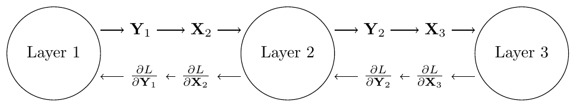
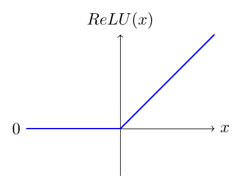
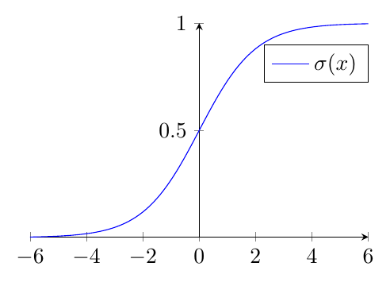
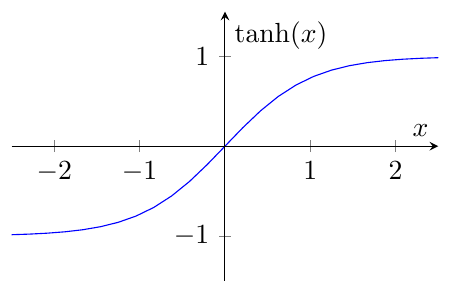

# Mathematical background for neural networks

## 1 Mathematical background

### 1.1 Introduction

Our neural network code is created with a modular design, where each layer of the
network is an instance of its respective layer class, which inherits from the base
class `Layer`. This allows for quick and easy creation and changes to the
network architecture. To achieve this, however, we need to compute the loss gradient
with repect to each layer regardless of the layer that came before it. We find that the
chain rule tells us that all we need to compute the gradient of a given layer is the
output gradient of that layer.
We can show this by the equation,

$$
\frac{\partial L}{\partial \mathbf{W}_i} = \frac{\partial L}{\partial \mathbf{Y}_i} \frac{\partial \mathbf{Y}_i}{\partial \mathbf{W}_i}
\tag{1}
$$

where $L$ is the loss function, $\frac{\partial L}{\partial \mathbf{Y}_i}$ is the output
gradient of layer $i$.
Since for layer $i$, the output $\mathbf{Y}_i$ is equal to the input $\mathbf{X}_{i+1}$
of the next layer $i+1$.
We also need to compute the input gradient with respect to each layer and return it for
use of the previous layer, for which it becomes the output graident.

$$
\frac{\partial L}{\partial \mathbf{Y}_i} = \frac{\partial L}{\partial \mathbf{X}_{i+1}}
\tag{2}
$$

   
  <em>Figure 1: Forward and backward pass of a neural network</em>

### 1.2 Fully Connected Layer

#### 1.2.1 Forward Propagation

Our dense or fully connected layer forward propagation is defined by the equation,

$$
\mathbf{Y} = \mathbf{W} \mathbf{X} + \mathbf{B}
\tag{3}
$$

where $\mathbf{X}$ is the input, $\mathbf{W}$ is the weight matrix, $\mathbf{B}$ is the
bias vector, and $\mathbf{Y}$ is the output. The weight matrix is of size $n \times m$
where $n$ is the number of output features and $m$ is the number of input features.
The bias vector is of size $m$. If the input matrix is of size $m \times o$ where $o$
is the number of samples, then the output matrix is of size $n \times o$.
We can write the $i$-th element of the $b$-th output vector in a batch of outputs as,

$$
y_i^{[b]} = \sum_{j=1}^{n} w_{i,j} x_j^{[b]} + b_i
\tag{4}
$$

#### 1.2.2 Loss Gradient with respect to the Weight Matrix

The error gradient with
respect to the weigth matrix is given by,

$$
\frac{\partial L}{\partial \mathbf{W}} = \frac{\partial L}{\partial \mathbf{Y}} \frac{\partial \mathbf{Y}}{\partial \mathbf{W}}
\tag{5}
$$

. Within our backward propagation method we are given the output gradient
$\frac{\partial L}{\partial \mathbf{Y}}$ as an argument. This leaves us to compute
$\frac{\partial \mathbf{Y}}{\partial \mathbf{W}}$. For any particular element of the
gradient $\frac{\partial \mathbf{Y}}{\partial \mathbf{W}}$ we can substitute equation
4 into the equation,

$$
\frac{\partial y^{[b]}_t}{\partial w_{i,j}} = \frac{\partial}{\partial w_{i,j}} \left( \sum_{j=1}^{n} w_{t,j} x_j^{[b]} + b_t \right) =
\begin{cases}
    x_j^{[b]} & \text{if } i = t \\
    0 & \text{otherwise}
\end{cases}
\tag{6}
$$

. Representing the gradient of the loss function with respect to the weight matrix as a
matrix, we have,

$$
\frac{\partial L}{\partial \mathbf{W}} =
\begin{bmatrix}
    \frac{\partial L}{\partial w_{1,1}} & \frac{\partial L}{\partial w_{1,2}} & \cdots & \frac{\partial L}{\partial w_{1,n}} \\
    \frac{\partial L}{\partial w_{2,1}} & \frac{\partial L}{\partial w_{2,2}} & \cdots & \frac{\partial L}{\partial w_{2,n}} \\
    \vdots & \vdots & \ddots & \vdots \\
    \frac{\partial L}{\partial w_{m,1}} & \frac{\partial L}{\partial w_{m,2}} & \cdots & \frac{\partial L}{\partial w_{m,n}}
\end{bmatrix}
\tag{7}
$$

. It follows from equation 6 that the gradient of the loss
function with respect a particular weight $w_{i,j}$ is given by,

$$
\frac{\partial L}{\partial w_{i,j}} = \sum_{b=1}^{o} \frac{\partial L}{\partial y^{[b]}_i} x_j^{[b]}
\tag{8}
$$

. Substituting equation 8 into equation 7 we
find the that final gradient of the loss function with respect to the weight matrix is
given by,

$$
\frac{\partial L}{\partial \mathbf{W}} = \frac{\partial L}{\partial \mathbf{Y}} \mathbf{X}^T
\tag{9}
$$

#### 1.2.3 Loss Gradient with respect to the Bias Vector

The error gradient with respect to the bias vector is given by,

$$
\frac{\partial L}{\partial \mathbf{B}} = \frac{\partial L}{\partial \mathbf{Y}} \frac{\partial \mathbf{Y}}{\partial \mathbf{B}}
\tag{10}
$$

. Again, we are given the output gradient $\frac{\partial L}{\partial \mathbf{Y}}$ as
an argument, so our task is to compute $\frac{\partial \mathbf{Y}}{\partial \mathbf{B}}$.
Referencing equation 4, we can see that the gradient of the
output with respect to the bias vector is given by,

$$
\frac{\partial y^{[b]}_i}{\partial b_j} = \frac{\partial}{\partial b_j} \left( \sum_{j=1}^{n} w_{i,j} x_j^{[b]} + b_i \right) =
\begin{cases}
    1 & \text{if } i = j \\
    0 & \text{otherwise}
\end{cases}
\tag{11}
$$

. Representing the gradient of the loss function with respect to the bias vector as a
vector, we have,

$$
\frac{\partial L}{\partial \mathbf{B}} =
\begin{bmatrix}
    \frac{\partial L}{\partial b_1} \\[0.5em]
    \frac{\partial L}{\partial b_2} \\[0.5em]
    \vdots \\[0.5em]
    \frac{\partial L}{\partial b_m}
\end{bmatrix}
\tag{12}
$$

. It follows that the gradient of the loss function with respect to a particular bias
$b_i$ is given by,

$$
\frac{\partial L}{\partial b_i} = \sum_{b=1}^{o} \frac{\partial L}{\partial y^{[b]}_i}
\tag{13}
$$

which is simply the sum of the loss gradients with respect to the output.

#### 1.2.4 Loss Gradient with respect to the Input

The error gradient with respect to the input is given by,

$$
\frac{\partial L}{\partial \mathbf{X}} = \frac{\partial L}{\partial \mathbf{Y}} \frac{\partial \mathbf{Y}}{\partial \mathbf{X}}
\tag{14}
$$

. Refering back to equation 4, we can substitute the equaiton
for the output. Hence,

$$
\frac{\partial y^{[b]}_i}{\partial x_j^{[b]}} = \frac{\partial}{\partial x_j^{[b]}} \left( \sum_{j=1}^{n} w_{i,j} x_j^{[b]} + b_i \right) = w_{i,j}
\tag{15}
$$

. Hence for the $b$-th sample of the input, the error gradient with respect to the input
is,

$$
\frac{\partial L}{\partial x^{[b]}_i} = \sum_{j=1}^{n} \frac{\partial L}{\partial y^{[b]}_j} \frac{\partial y^{[b]}_j}{\partial x^{[b]}_i} =
\sum_{j=1}^{n} \frac{\partial L}{\partial y^{[b]}_j} w_{j,i}
\tag{16}
$$

. We find that this equation can expanded to all samples in the batch and the
equation,

$$
\frac{\partial L}{\partial \mathbf{X}} = \mathbf{W}^T \frac{\partial L}{\partial \mathbf{Y}}
\tag{17}
$$

represents the full gradient of the loss function with respect to the input.

### 1.3 Convolutional Layer

#### 1.3.1 Forward Propagation

The convolutional layer is a layer that takes a 3 dimensional input, where the first
two dimensions are the height and width of the input (usually pixel values of an
image), and the third dimension is the of channels of the input. The convolutional
layer is defined by the equation,

$$
\mathbf{Y}_{i}^{[b]} = \sum_{j=1}^n \mathbf{X}_{j}^{[b]} \ast  \mathbf{F}_{j,i} + \mathbf{B}_{i}
\tag{18}
$$

where $\mathbf{Y}_{i}^{[b]}$ is the $i$-th channel of the $b$-th sample of the output ,
$\mathbf{X}_{j}^{[b]}$ is the $j$-th channel of the $b$-th sample of the input,
$\mathbf{F}_{j,i}$ is the $j$-th channel of the $i$-th filter, $\mathbf{B}_{i}$ is the
$i$-th bias vector and $\ast$ is the convolution operator. The convolution operator
is a operation that takes a filter in the form of a 2d matrix and an in input in the
form of a 2d matrix, the filter slides of the input and computes the sum of the
element-wise product of the filter and the input. For the example the convolution
of a $2 \times 2$ filter and a $3 \times 3$ input is shown below:

$$
\begin{bmatrix}
    x_{1,1} & x_{1,2} & x_{1,3} \\
    x_{2,1} & x_{2,2} & x_{2,3} \\
    x_{3,1} & x_{3,2} & x_{3,3} \\
\end{bmatrix} \ast
\begin{bmatrix}
    f_{1,1} & f_{1,2} \\
    f_{2,1} & f_{2,2} \\
\end{bmatrix} =
\begin{bmatrix}
    o_{1,1} & o_{1,2} \\
    o_{2,1} & o_{2,2} \\
\end{bmatrix}
\tag{19}
$$

where

$$
\begin{aligned}
    o_{1,1} &= x_{1,1}f_{1,1} + x_{1,2}f_{1,2} + x_{2,1}f_{2,1} + x_{2,2}f_{2,2}\\
    o_{1,2} &= x_{1,2}f_{1,1} + x_{1,3}f_{1,2} + x_{2,2}f_{2,1} + x_{2,3}f_{2,2}\\
    o_{2,1} &= x_{2,1}f_{1,1} + x_{2,2}f_{1,2} + x_{3,1}f_{2,1} + x_{3,2}f_{2,2}\\
    o_{2,2} &= x_{2,2}f_{1,1} + x_{2,3}f_{1,2} + x_{3,2}f_{2,1} + x_{3,3}f_{2,2}.
\end{aligned}
\tag{20}
$$

#### 1.3.2 Loss gradient with respect to the filter

The loss gradient with respect to the filter is given by,

$$
\frac{\partial L}{\partial \mathbf{F}} = \frac{\partial L}{\partial \mathbf{Y}} \frac{\partial \mathbf{Y}}{\partial \mathbf{F}}.
\tag{21}
$$

Analyzing a simple case with a single kernel, a single input channel and a single sample
for a $3 \times 3$ input and a $2 \times 2$ filter, we can see that the elements of the
output are given by,

$$
\begin{aligned}
    y_{1,1} &= x_{1,1}f_{1,1} + x_{1,2}f_{1,2} + x_{2,1}f_{2,1} + x_{2,2}f_{2,2} +
    b_{11} \\
    y_{1,2} &= x_{1,2}f_{1,1} + x_{1,3}f_{1,2} + x_{2,2}f_{2,1} + x_{2,3}f_{2,2} +
    b_{12} \\
    y_{2,1} &= x_{2,1}f_{1,1} + x_{2,2}f_{1,2} + x_{3,1}f_{2,1} + x_{3,2}f_{2,2} +
    b_{21} \\
    y_{2,2} &= x_{2,2}f_{1,1} + x_{2,3}f_{1,2} + x_{3,2}f_{2,1} + x_{3,3}f_{2,2} +
    b_{22}.
\end{aligned}
\tag{22}
$$

Hence, using the chain rule the equaiton

$$
\frac{\partial L}{\partial f_{1,1}} = \frac{\partial L}{\partial y_{1,1}} \frac{\partial y_{1,1}}{\partial f_{1,1}} + \frac{\partial L}{\partial y_{1,2}} \frac{\partial y_{1,2}}{\partial f_{1,1}} + \frac{\partial L}{\partial y_{2,1}} \frac{\partial y_{2,1}}{\partial f_{1,1}} + \frac{\partial L}{\partial y_{2,2}} \frac{\partial y_{2,2}}{\partial f_{1,1}}
\tag{23}
$$

represents the gradient of the loss function with respect to the 1st row and 1st column
of the filter. Taking the derivatives of the output with respect to the filter, the
equation becomes,

$$
\frac{\partial L}{\partial f_{1,1}} = \frac{\partial L}{\partial y_{1,1}} x_{1,1} + \frac{\partial L}{\partial y_{1,2}} x_{1,2} + \frac{\partial L}{\partial y_{2,1}} x_{2,1} + \frac{\partial L}{\partial y_{2,2}} x_{2,2}.
\tag{24}
$$

Repeating this process for all elements of the filter, we find that the gradient of the
loss function with respect to the filter in the general case is given by,

$$
\frac{\partial L}{\partial \mathbf{F}_{i,j}} = \sum_{b=1}^{o} \mathbf{X}_{j}^{[b]} \ast \frac{\partial L}{\partial \mathbf{Y}_{i}^{[b]}}
\tag{25}
$$

where $F_{i,j}$ is the $i$-th channel of the $j$-th filter, $X_{j}^{[b]}$ is the $j$-th
channel of the $b$-th sample of the input, and $Y_{i}^{[b]}$ is the $i$-th channel of
the $b$-th sample of the output.

### 1.4 Activation Functions

Activation functions are used to introduce non-linearity into our neural network. We
used a total of four activation functions in our code, the ReLU, Sigmoid, Tanh, and
Softmax functions. Since all activation functions are not trainable, we only need to
compute the input gradient. The input gradient is given by,

$$
\frac{\partial L}{\partial \mathbf{X}} = \frac{\partial L}{\partial \mathbf{Y}} \frac{\partial \mathbf{Y}}{\partial \mathbf{X}}
\tag{26}
$$

. Hence, for each activation function we simply need to compute the derivative of the
function with respect to the input.

#### 1.4.1 ReLU

The ReLU function is defined as,

$$
f(x) =
\begin{cases}
    x & \text{if } x > 0 \\
    0 & \text{otherwise}
\end{cases}
\tag{27}
$$

   
  <em>Figure 2: ReLU function</em>

Following equation 26, the input gradient is given by,

$$
\frac{\partial L}{\partial \mathbf{X}} =
\frac{\partial L}{\partial \mathbf{Y}} f'(\mathbf{X}) =
\frac{\partial L}{\partial \mathbf{Y}}
\begin{cases}
    1 & \text{if } x > 0 \\
    0 & \text{otherwise}
\end{cases}
\tag{28}
$$

#### 1.4.2 Sigmoid

The sigmoid function is defined as,

$$
f(x) = \frac{1}{1 + e^{-x}}
\tag{29}
$$

   
  <em>Figure 3: Sigmoid function</em>

The derivative of the sigmoid function is given by,

$$
f'(x) = f(x)(1 - f(x))
\tag{30}
$$

Hence, the input gradient is given by,

$$
\frac{\partial L}{\partial \mathbf{X}} =
\frac{\partial L}{\partial \mathbf{Y}} f'(\mathbf{X}) =
\frac{\partial L}{\partial \mathbf{Y}} f(\mathbf{X})(1 - f(\mathbf{X}))
\tag{31}
$$

#### 1.4.3 Tanh

The tanh function is defined as,

$$
f(x) = \frac{e^x - e^{-x}}{e^x + e^{-x}}
\tag{32}
$$

   
  <em>Figure 4: Tanh function</em>

The derivative of the tanh function is given by,

$$
f'(x) = 1 - f(x)^2
\tag{33}
$$

Hence, the input gradient is given by,

$$
\frac{\partial L}{\partial \mathbf{X}} =
\frac{\partial L}{\partial \mathbf{Y}} f'(\mathbf{X}) =
\frac{\partial L}{\partial \mathbf{Y}} (1 - f(\mathbf{X})^2)
\tag{34}
$$

#### 1.4.4 Softmax

The softmax function is a unique activation function, that usually is only used on the
output layer of a neural network. The softmax function is used to convert the output of
a layer into a probability distribution. This is incredibly useful for classification
problems. The softmax function is used on a vector of $n$ elements, and is defined as,

$$
f(x_i) = \frac{e^{x_i}}{\sum_{j=1}^{n} e^{x_j}}
\tag{35}
$$

where $x_i$ is the $i$-th component of the vector and $f(x_i)$ is the probability of the $i$-th component of the vector.

## 2 Loss Functions

### 2.1 Mean Squared Error

The mean squared error is defined as,

$$
L = \frac{1}{o} \sum_{i=1}^{o} \sum_{j=1}^{n} (y_{i,j} - \hat{y}_{i,j})^2
\tag{36}
$$

where $o$ is the number of samples, $n$ is the number of output features, $y_{i,j}$ is
the $j$-th component of the $i$-th sample, and $\hat{y}_{i,j}$ is the $j$-th predicted
component of the $i$-th sample. The derivative of the loss function with respect to the
final output ($\mathbf{\hat{Y}}$) is given by,

$$
\frac{\partial L}{\partial \mathbf{\hat{Y}}} = \frac{2}{o} (\mathbf{\hat{Y}} - \mathbf{Y})
\tag{37}
$$

. The output of this function is then passed to the output layer for back propagation.
The mean squared error loss function is used extensively for regression problems.

### 2.2 Cross Entropy

The cross entropy loss function is defined as,

$$
L = -\frac{1}{o} \sum_{b=1}^{o} \sum_{i=1}^{n} y_{i}^{[b]} \log(\hat{y}_{i}^{[b]})
\tag{38}
$$

where $o$ is the number of samples, $n$ is the number of output features, $y_{i}^{[b]}$
is the $i$-th component of the $b$-th sample, and $\hat{y}_{i}^{[b]}$ is the $i$-th
predicted component of the $b$-th sample. The cross entropy loss function is used
primarily for classification problems. Since the softmax activation function is often
found on the output layer of a classification network, it is useful to compute the
derivative of the loss function with respect to a softmaxed output. Considering
a softmaxed output, the loss function becomes,

$$
L = -\frac{1}{o}\sum_{b=1}^{o}\sum_{i=1}^{n}y_{i}^{[b]}\log(\text{Softmax}(z^{[b]}_{i}))
\tag{39}
$$

where $z^{[b]}_{i}$ is the $i$-th component of the $b$-th sample of the output of the
non-softmaxed output layer.
Looking at just the the loss function for a single sample, we can see that the
derivative with respect to the output layer is:

$$
\begin{aligned}
    L_{i} &= -\sum_{j=1}^{10}y_{j}\log(a_{j}) \\
    \frac{\partial L_{i}}{\partial z^{[2]}_{i}} &= - \sum_{k=1}^{10}y_{k}\frac{\partial
        \log(a_{k})}{\partial z^{[2]}_{i}} \\
    &= - \sum_{k=1}^{10}y_{k}\frac{1}{a_{k}}\frac{\partial a_{k}}{\partial z^{[2]}_{i}}
\end{aligned}
$$

The derivative of the softmax function is:

$$
\frac{\partial a_{k}}{\partial z^{[2]}_{i}} = \begin{cases}
    a_{k}(1-a_{k}) & \text{if } k = i \\
    -a_{k}a_{i} & \text{if } k \neq i
\end{cases}
\tag{40}
$$

Hence:

$$
\begin{aligned}
    \frac{\partial L_{i}}{\partial z^{[2]}_{i}} &= -y_{j}(1-a_{j}) - \sum_{k \neq j}y_{k}a_{j}\\
                                                &= a_{j} \left( y_{j} + \sum_{k \neq j}y_{k} \right) - y_{j}
\end{aligned}
$$

Since $\sum_{k}y_{k} = 1$ and $y_{j} + \sum_{k \neq i}y_{k} = 1$, we have:

$$
\frac{\partial L_{i}}{\partial z^{[2]}_{i}} = a_{j} - y_{j}
\tag{41}
$$

Hence:

$$
\frac{\partial L}{\partial Z} = \hat{Y} - Y
\tag{42}
$$
